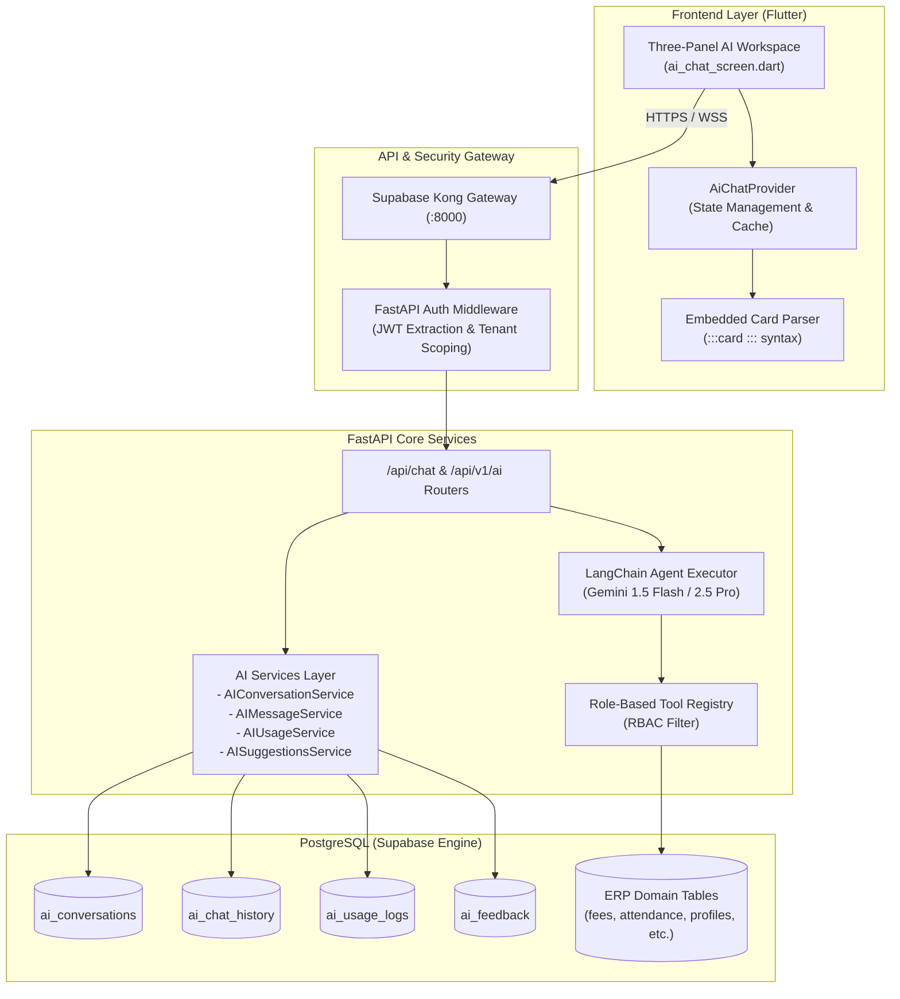

# EduSHAMIIT ERP - AI Assistant Implementation Guide

## 1. Executive Summary

The **EduSHAMIIT AI Assistant** (branded internally as **Shami AI**) is a context-aware, enterprise-grade AI copilot integrated across the entire EduSHAMIIT ERP ecosystem. It serves administrators, directors, principals, teachers, accountants, librarians, hostel wardens, transport staff, students, and parents.

Rather than acting as a generic LLM wrapper, the AI Assistant operates as an intelligent ERP orchestrator capable of natural language understanding (English, Hindi, and Hinglish), parameterized data retrieval, cross-module correlation, report generation, and safe action drafting.

---

## 2. System Architecture

The AI Assistant follows a strict three-tier architecture ensuring tenant isolation, defense-in-depth security, and real-time responsiveness.

---

## 3. Frontend Implementation & UI/UX

### 3.1 Design System & Visual Alignment
The chat interface was upgraded to match the target executive design specification (`media_1794062378830_e6ceb9d4.jpg`), featuring:
- **Top Banner**: Robot assistant icon in a rounded container, "AI Assistant Beta" pill badge, and descriptive subtitle.
- **Three-Panel Layout**:
  1. **Left Panel (260px)**: Collapsible Conversation History.
     - New Chat blue primary CTA.
     - Search conversations input with instant client filtering.
     - Categorized sections: *Recent Conversations*, *Today*, *Yesterday*, *Previous 7 Days*, *Archived*.
     - Dynamic topic icon badges (Reports, Attendance, Finance, Timetable, Bus).
     - Context menu on each conversation: Pin/Unpin, Rename dialog, Archive/Unarchive, Export (JSON/Text), Delete confirmation.
  2. **Center Panel (Flexible Workspace)**:
     - Active conversation title and subtitle context.
     - "Clear Chat" header action.
     - Conversation stream with distinct user message bubbles and assistant responses.
     - Indian Rupee (`₹`) formatted metrics.
     - **Interactive Embedded Action Cards**: Custom-rendered components from markdown syntax `:::card type="..." title="..." subtitle="..." action="..." url="..." :::` featuring direct ERP deep navigation buttons (`[View Report]`, `[View Pending Fee List]`, `[Open HR Desk]`).
     - Message action toolbar: One-click Copy, Text-to-Speech (TTS), Regenerate Response, Thumbs Up / Thumbs Down feedback.
     - Composer footer: File/Image attachments, multiline auto-expanding text box, Voice/Speech-to-Text (STT) mic button, and Send button.
     - Disclaimer caption: *"AI can make mistakes. Verify important information before taking action."*
  3. **Right Panel (280px)**: Quick Actions & Context Assistant.
     - Personalized greeting card (*"Hello Admin! I'm your EduSHAMIIT AI Assistant..."*).
     - **2x3 Quick Action Grid**: Generate Report, Student Search, Attendance Query, Fee Report, Timetable, Send Notice.
     - **Suggested Questions List**: Contextual prompt chips with chevron arrows (`->`) that instantly dispatch queries to the chat stream.
     - Helpful Tip Card and Security Privacy Badge (*"AI uses only the information you are authorized to access."*).
     - Responsive behavior: On tablet and mobile displays, Left and Right panels seamlessly collapse into accessible modal drawers.

### 3.2 State Management (`AiChatProvider`)
The frontend state is managed via Flutter Provider:
- `List<ChatMessage> messages`: The reactive message list supporting status flags (`sending`, `received`, `error`), tokens, and feedback ratings.
- `List<Map<String, dynamic>> sessions`: Multi-session conversation list supporting pinning, archiving, and active session selection.
- `loadSessions()`: Fetches conversations from `/api/v1/ai/conversations`.
- `createSession()`: Starts a clean conversation session.
- `renameSession()`, `togglePinSession()`, `toggleArchiveSession()`, `deleteSession()`: Immediate optimistic updates backed by backend persistence.
- `submitFeedback()`: Records user ratings (+1 / -1) and feedback text directly to `/api/v1/ai/feedback`.
- `loadSuggestions()`: Fetches role-scoped quick actions and suggestion chips from `/api/v1/ai/suggestions`.

---

## 4. Backend Implementation & Service Layer

### 4.1 Database Enhancements (Migration 427)
Applied schema enhancements to Postgres (`public` schema):
- `ai_conversations`: Tracks conversation sessions, titles, pinned state, archive state, models, and tenant isolation (`school_id`, `user_id`).
- `ai_chat_history`: Enriched with `feedback_rating`, `feedback_text`, `status`, `tokens_used`, `duration_ms`, `metadata`, and `parent_message_id`.
- `ai_attachments`: Stores attached file metadata, URLs, MIME types, and document extraction payloads.
- `ai_tool_executions`: Complete audit log of all tool calls, input arguments, execution latencies, and execution status.
- `ai_usage_logs`: Telemetry logs for provider, model, token usage, estimated cost, and response latency.
- `ai_feedback`: Formal user ratings and textual reviews linked to messages.
- `ai_provider_configs`: Configurable provider/model registry (Google Gemini, OpenAI, Claude) per school.

### 4.2 AI Assistant Service (`ai_assistant_service.py`)
Modular services encapsulated into clean classes:
- **`AIConversationService`**: Full CRUD operations for conversation sessions, search filtering, pinning, archiving, and multi-format exports (JSON and Plain Text).
- **`AIMessageService`**: Records feedback ratings (+1 for helpful, -1 for unhelpful) and comments, updating both `ai_chat_history` and `ai_feedback`.
- **`AIUsageService`**: Logs token consumption and computes estimated API costs in INR based on model tariffs.
- **`AISuggestionsService`**: Dynamically generates role-appropriate quick actions and suggested questions tailored to the caller's permissions (Admin, Teacher, Student, Finance, etc.).

---

## 5. Enterprise ERP Tools Integration

All ERP data retrieval is strictly executed through parameterized service functions decorated with LangChain's `@tool`. The LLM has zero direct SQL execution rights.

| Tool Name | Scope | Role Permissions | Description |
|---|---|---|---|
| `get_fee_collection_report` | Finance | Admin, SuperAdmin, Director, Principal, Accountant | Aggregates collected vs pending fees, calculates collection percentage, and embeds `[View Report]` card. |
| `get_pending_fee_students` | Finance | Admin, SuperAdmin, Director, Principal, Accountant | Lists student fee defaulters, highest/lowest dues, and embeds `[View Pending Fee List]` card. |
| `get_school_attendance_summary` | Attendance | Admin, SuperAdmin, Principal, Teacher | Summarizes present/absent counts, percentage rates, class highlights, and embeds `[View Attendance Details]` card. |
| `get_student_enrollment_overview` | Academics | Admin, SuperAdmin, Principal, Teacher | Analyzes student enrollment, active student profiles, gender ratio, and admission statistics. |
| `get_hostel_status_summary` | Hostel | Admin, SuperAdmin, Warden, Hostel Warden | Reports occupied vs vacant beds, room occupancy rates, and pending maintenance tickets. |
| `get_library_status_summary` | Library | Admin, SuperAdmin, Librarian | Tracks total book catalogue, issued titles, overdue loans, and fine summaries. |
| `get_transport_fleet_summary` | Transport | Admin, SuperAdmin, Transport Manager, Driver | Summarizes active bus routes, vehicles in transit, fitness renewals, and insurance statuses. |
| `get_hr_staff_summary` | HR | Admin, SuperAdmin, Director, HR Manager | Summarizes active teachers and non-teaching staff, staff on leave today, and pending leave applications. |
| `draft_school_notice` | Communication | Admin, SuperAdmin, Director, Principal | Prepares a notice draft preview for student, parent, or staff distribution without auto-publishing. |
| `correlate_attendance_and_fees` | Analytics | Admin, SuperAdmin, Director, Principal | Cross-module intelligence comparing classroom attendance against fee clearance. |

---

## 6. Safety & Confirmation Workflows

Any tool capable of altering state or broadcasting messages to the school community enforces an explicit **Human-in-the-Loop (HITL)** confirmation flow:
1. When a user requests a notice (*"Draft a notice for sports day"*), `draft_school_notice` generates a **Draft Preview**.
2. The response explicitly states: `Status: DRAFT (Pending Human Approval) - NOT published automatically`.
3. The response embeds an action card `:::card type="notice_draft" action="Review in Notices Module" url="/admin/notices" :::`.
4. The user must review and manually authorize publishing inside the ERP Notices module. No automatic database writes occur without confirmation.

---

## 7. Verification & Status

- **Database Migration 427**: Applied and validated in PostgreSQL container `supabase-db`.
- **Backend API Endpoints**: Tested and mounted at `/api/chat` and `/api/v1/ai`.
- **Flutter Analyzer**: 0 errors across `edu_shamiit_core` and `edu_shamiit_admin`.
- **Unit & Integration Tests**: 12/12 passing (`test_ai_conversations.py`, `test_ai_erp_tools.py`, `test_ai_security_multitenancy.py`, `test_ai_usage_and_suggestions.py`).
- **End-to-End Automation**: `scripts/test_ai_assistant_e2e.py` executed successfully with 0 failures and 100% pass rate.
